<p align="center">
  
</p>

<h3 align="center">Systems &amp; AI engineer building local-first tools in Rust.</h3>

<p align="center">
  <a href="https://sreevarshan-peach.vercel.app/"></a>
  <a href="mailto:sreevarshan1511@gmail.com"></a>
  <a href="https://x.com/sreevarshan298"></a>
  <a href="https://codepen.io/sree-varshan"></a>
  
</p>

<p align="center">
  <a href="#about">About</a> ·
  <a href="#work">Selected Work</a> ·
  <a href="#lab">Lab</a> ·
  <a href="#journey">Journey</a> ·
  <a href="#stack">Stack</a> ·
  <a href="#activity">Activity</a>
</p>

<a id="about"></a>

## `❯ cat about.rs`

```rust
let sree = Engineer {
    name:      "Sree Varshan V",
    role:      "Systems & AI Engineer",
    daily:     "Arch Linux · Hyprland · Neovim",
    writes:    ["Rust", "Python", "TypeScript", "Go", "Kotlin"],
    builds:    ["local-first AI agents", "native desktop tools", "voice assistants"],
    believes:  "Your code and your data should stay on your machine.",
    open_to:   "collaboration on Rust tooling & on-device AI",
};

assert!(sree.ships_more_than_tweets());
```

I build AI products end to end, from the model and the agent loop down to the binary that runs on your machine.
I care about latency, memory limits, privacy, and whether the thing actually works on a Tuesday afternoon, not only about benchmark scores.

<a id="work"></a>

## `❯ ls ~/work`

<table>
  <tr>
    <td width="50%" valign="top">
      <h3>⚡ <a href="https://github.com/sreevarshan-xenoz/xencode">xencode</a></h3>
      A terminal-native <b>AI coding agent</b> built for free, open-weight models. It runs on Ollama, llama.cpp, a free Colab GPU or any OpenAI-compatible endpoint, with a provider fallback chain and an approval-gated tool loop.<br/><br/>
      <sub><code>Rust</code> · <code>20 crates</code> · <code>~3,000 tests</code> · <code>Zed ACP</code></sub>
    </td>
    <td width="50%" valign="top">
      <h3>📱 <a href="https://github.com/sreevarshan-xenoz/Pocketdesk">Pocketdesk</a></h3>
      <b>Your desktop on your phone.</b> A low-latency remote desktop for Wayland-native Linux and Windows, with the KDE Connect feature set built in. Works over LAN, Tailscale or iroh, with no port forwarding and no account.<br/><br/>
      <sub><code>Rust</code> · <code>QUIC</code> · <code>H.264/HEVC</code> · <code>Android</code></sub>
    </td>
  </tr>
  <tr>
    <td width="50%" valign="top">
      <h3>🛸 <a href="https://github.com/sreevarshan-xenoz/codehalo">CodeHalo</a></h3>
      A GPU-accelerated desktop HUD that tracks your AI coding agents (Claude Code, Codex, Cursor, Gemini) in one edge-docked pill. It uses no Electron and no WebView.<br/><br/>
      <sub><code>Rust</code> · <code>Qt 6 / QML</code> · <code>Windows + Linux</code></sub>
    </td>
    <td width="50%" valign="top">
      <h3>🔗 <a href="https://github.com/sreevarshan-xenoz/fluxbond">FluxBond</a></h3>
      An Internet bonding layer that merges Wi-Fi, 5G and Ethernet into one resilient link, so ordinary apps get the combined bandwidth without any changes.<br/><br/>
      <sub><code>Rust</code> · <code>Networking</code> · <code>Packet scheduling</code></sub>
    </td>
  </tr>
  <tr>
    <td width="50%" valign="top">
      <h3>🧾 <a href="https://github.com/sreevarshan-xenoz/LedgerMind">LedgerMind</a></h3>
      An AI finance-ops agent for multi-source reconciliation, built for the Razorpay Buildathon. A deterministic core matches 59k+ records/sec, and the agent investigates exceptions with <b>zero false reconciliations</b>.<br/><br/>
      <sub><code>Python</code> · <code>Agents</code> · <a href="https://ledger-mind-iota.vercel.app">Live demo ↗</a></sub>
    </td>
    <td width="50%" valign="top">
      <h3>🎙️ <a href="https://github.com/sreevarshan-xenoz/Iris-Agent">Iris</a></h3>
      A voice-first AI assistant for Arch Linux that hears, thinks, remembers and speaks. It runs Faster-Whisper on the GPU, Silero VAD, streaming LLMs and Kokoro TTS, with SQLite memory.<br/><br/>
      <sub><code>Python</code> · <code>CUDA</code> · <code>Speech</code></sub>
    </td>
  </tr>
</table>

<details>
<summary><b>🧰 More from the workshop</b></summary>
<br/>

| Project | What it is | Stack |
|---|---|---|
| [AniTerm](https://github.com/sreevarshan-xenoz/AniTerm) | TUI anime client with AniList sync, MPV playback and themes | Rust · Ratatui |
| [metapak](https://github.com/sreevarshan-xenoz/metapak) | One TUI for pacman, apt, brew, scoop, npm, pip and cargo | Rust |
| [project-buddy](https://github.com/sreevarshan-xenoz/project-buddy) | A terminal group chat where your logged-in AI web sessions debate, vote and converge on an answer | Go · TypeScript |
| [project-friday](https://github.com/sreevarshan-xenoz/project-friday) | A plugin-based desktop AI agent that operates Windows like a human | Rust |
| [ECHOLINK](https://github.com/sreevarshan-xenoz/ECHOLINK-A-Real-Time-Chat-Application) | Secure real-time chat with AI features | JavaScript |
| [my-hyprland-config](https://github.com/sreevarshan-xenoz/my-hyprland-config) | The rice I live in every day | Shell · QML |

</details>

<a id="lab"></a>

## `❯ cd ~/lab`

- **[riya](https://github.com/sreevarshan-xenoz/riya)** is a research prototype of an AI with an affective core. It combines a Gated DeltaNet + attention hybrid LM, a JEPA world model, and homeostatic drives that shape how it speaks. It trains on a free Colab T4.
- **On-device inference** means making local models genuinely useful on consumer GPUs instead of being a fallback.
- **Agent reliability** covers approval gates, fallback chains, and evidence-backed decisions over vibes.

<a id="journey"></a>

## `❯ git log --graph`

<p align="center">
  
</p>

<a id="stack"></a>

## `❯ which --all stack`

<p>
  <b>Languages</b><br/>
  
</p>
<p>
  <b>AI / ML</b><br/>
  
</p>
<p>
  <b>Systems, Apps &amp; Infra</b><br/>
  
</p>
<p>
  <b>Tools &amp; Creative</b><br/>
  
</p>

<details>
<summary><b>🐛 Side quest: spot the bug</b></summary>
<br/>

This route picker returns `None` even when routes exist. Why?

```python
def select_best_route(routes):
    best_score = float("inf")
    best_route = None

    for route in routes:
        score = route["time_min"] + route["energy_kwh"] * 0.7
        if score > best_score:
            best_score = score
            best_route = route

    return best_route
```

<details>
<summary><b>✅ Reveal answer</b></summary>

`best_score` starts at infinity, but the comparison is `>`. No finite score is greater than infinity, so `best_route` never updates.
The fix is `if score < best_score:`. If you wanted the max instead, start from `float("-inf")`.

</details>
</details>

<a id="activity"></a>

## `❯ btop --github`

<p align="center">
  
  
</p>

<p align="center">
  <picture>
    <source media="(prefers-color-scheme: dark)" srcset="https://raw.githubusercontent.com/sreevarshan-xenoz/sreevarshan-xenoz/output/github-contribution-grid-snake-dark.svg">
    <source media="(prefers-color-scheme: light)" srcset="https://raw.githubusercontent.com/sreevarshan-xenoz/sreevarshan-xenoz/output/github-contribution-grid-snake.svg">
    
  </picture>
</p>

<p align="center">
  <code>❯ exit 0</code><br/>
  <sub>Thanks for scrolling. If something here sparks an idea, <a href="mailto:sreevarshan1511@gmail.com">say hi</a>.</sub>
</p>
